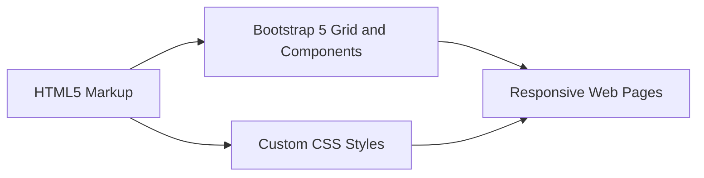
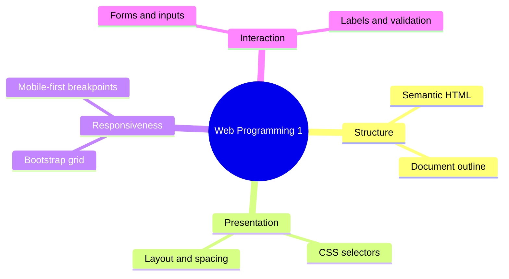

# Web Programming 1


A collection of coursework projects for an introductory Web Programming course. The projects cover semantic HTML structure, responsive layouts with Bootstrap, form handling, and a multi-page static website built with custom CSS.

## Table of Contents

- [Overview](#overview)
- [Repository Structure](#repository-structure)
- [Projects](#projects)
- [Technologies](#technologies)
- [Getting Started](#getting-started)
- [Usage](#usage)
- [Learning Objectives](#learning-objectives)
- [License](#license)

## Overview

This repository holds the assignments and practice projects completed during Web Programming 1. Each project is a standalone static website that can be opened directly in a web browser without a build step or server.

## Repository Structure

```text
web-programming-1/
├── First assigment workshop clone.html
├── Second Assignment workshop registration.html
└── starbucksclone/
    ├── index.html
    ├── rewards.html
    └── styles.css
```

## Projects

| Project | File(s) | Description |
|---------|---------|-------------|
| Creative Workshop Schedule | `First assigment workshop clone.html` | A card-based schedule page using Bootstrap grid utilities and inline styling for a three-session workshop. |
| Web Design Workshop Registration | `Second Assignment workshop registration.html` | A responsive two-column layout with an event details panel and a session registration form. |
| Starbucks Clone | `starbucksclone/` | A multi-page recreation of a coffee brand website, with a home page, a rewards page, and a shared stylesheet. |

## Technologies



- HTML5 for document structure and semantic elements
- CSS3 for custom styling and layout
- Bootstrap 5.3.3 loaded from the jsDelivr CDN for responsive grids, cards, badges, and form controls

## Getting Started

### Prerequisites

- A modern web browser such as Chrome, Firefox, Edge, or Safari
- Git (optional, for cloning the repository)
- An internet connection for loading the Bootstrap CDN stylesheet

### Installation

```bash
git clone https://github.com/Bisrat-joseph/web-programming-1.git
cd web-programming-1
```

## Usage

No installation or build process is required. Open any HTML file directly in the browser:

- Double-click the file in your file explorer, or
- Right-click the file and choose Open with your preferred browser.

For the Starbucks clone, open `starbucksclone/index.html` first and navigate to `rewards.html` from there.

For a live preview with automatic reload during development, a lightweight static server can be used:

```bash
python -m http.server 8000
```

Then visit `http://localhost:8000` in the browser.

## Learning Objectives



## License

This project was created for educational purposes as part of coursework. No license is granted for commercial use.
