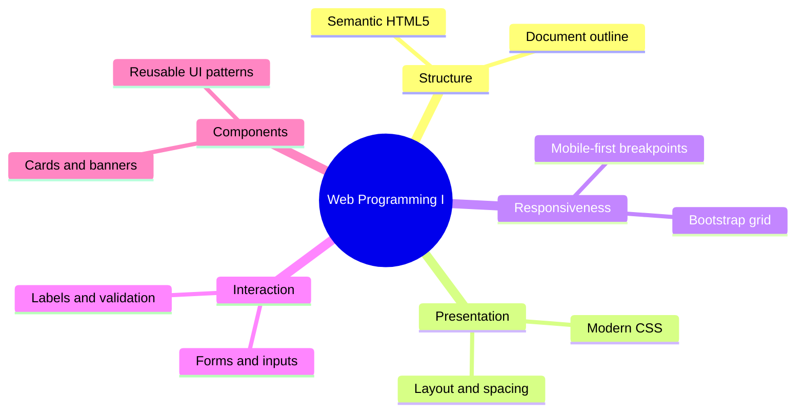
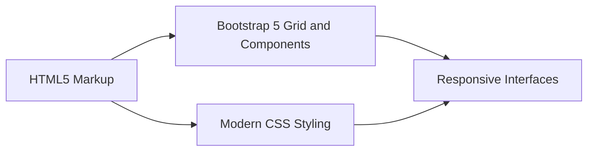

# Web Programming 1


A collection of practical web development coursework, assignments, labs, UI experiments, and hands-on frontend practice for Web Programming I.

## Table of Contents

- [Overview](#overview)
- [Topics Covered](#topics-covered)
- [Technologies](#technologies)
- [Getting Started](#getting-started)
- [License](#license)

## Overview

This repository documents hands-on frontend practice from an introductory Web Programming course. It serves as a working space for building, testing, and refining small interfaces, with an emphasis on writing clean markup, styling it deliberately, and making it work across screen sizes.

## Topics Covered



## Technologies



- HTML5 for document structure and semantic elements
- CSS3 for custom styling, layout, and theming
- Bootstrap 5.3.3, loaded from a CDN, for responsive grids, components, and form controls

## Getting Started

### Prerequisites

- A modern web browser such as Chrome, Firefox, Edge, or Safari
- Git, optional, for cloning the repository
- An internet connection for loading CDN-hosted stylesheets

### Installation

```bash
git clone https://github.com/Bisrat-joseph/web-programming-1.git
cd web-programming-1
```

No build step or package installation is required. Open any HTML page directly in a browser, or serve the directory with a lightweight static server for live testing:

```bash
python -m http.server 8000
```

## License

This project was created for educational purposes as part of coursework. No license is granted for commercial use.
